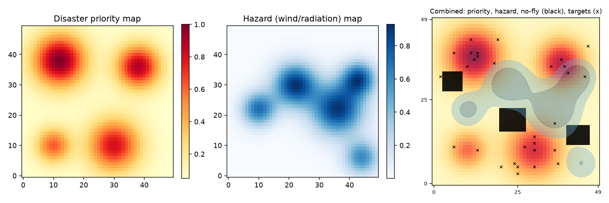
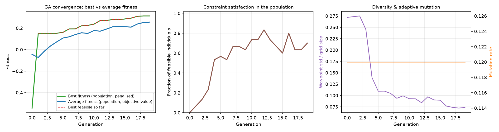
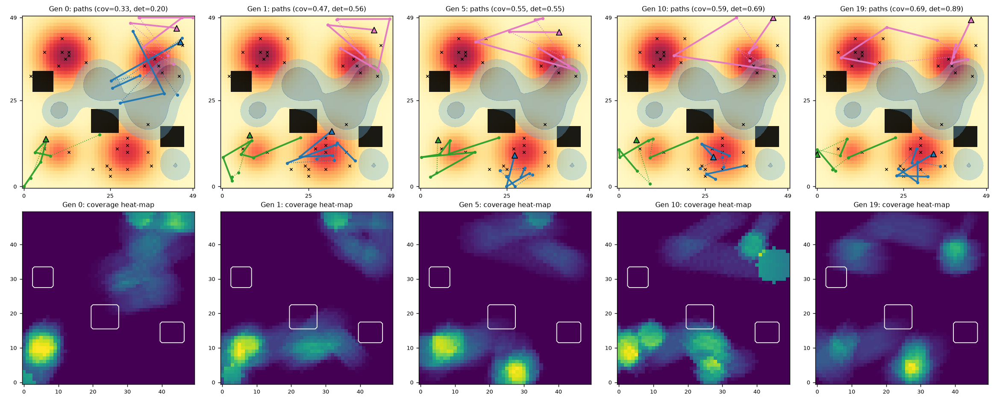
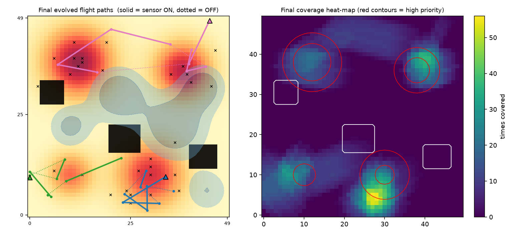
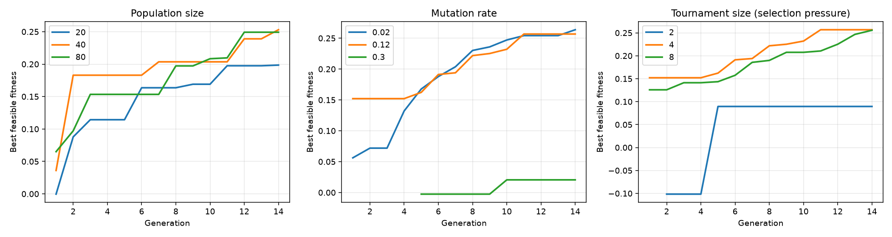
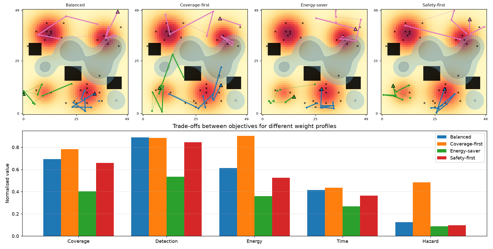
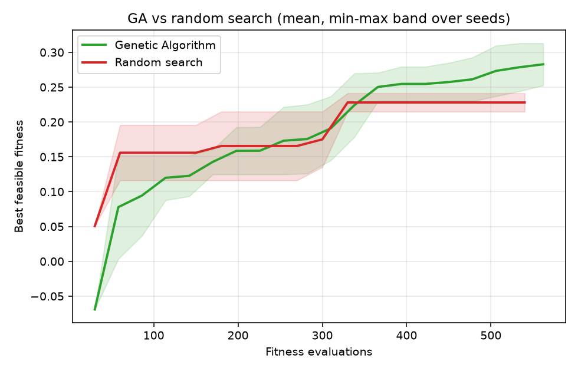
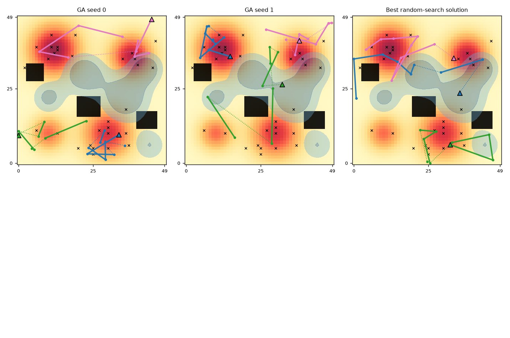

**Strategy Engine for a UAV Fleet using a Genetic Algorithm**

Artificial Intelligence – BSCS 5, Bahria University Lahore Campus – Assignment 2 (CLO4)

**Name:** Janeeta Khalil    **Roll No:** 03-134242-030

---

### 1. Problem and System Overview

Three UAVs survey a 50×50 grid containing four disaster hotspots (priority map), five wind/radiation pockets (hazard map), three rectangular no-fly zones, and 30 hidden targets. The engine decides, for every drone, where to deploy, which waypoints to fly, how fast, and when and how strongly to run the sensor. The objectives conflict: sweeping everything at full sensor power maximises coverage but drains the battery and crosses hazards; staying safe and cheap leaves hotspots unseen. There is no single optimum, only trade-offs. A Genetic Algorithm suits this because the landscape is non-convex, partly discrete (sensor ON/OFF), and can only be evaluated by simulation.

*Figure 1: Priority map, hazard map, and combined view with no-fly zones (black) and hidden targets (×).*

---

### 2. Chromosome Design

A hybrid real/binary multi-segment chromosome. For each drone *d* and segment *k* = 1..8:

| Gene block | Type | Meaning |
|---|---|---|
| deploy[d] (x, y) | real | deployment cell |
| wp[d,k] (x, y) | real | waypoint k (path = deploy → wp1 → … → wp8) |
| speed[d,k] | real in [0.5, 2] | cruise speed on segment k |
| power[d,k] | real in [0, 1] | sensor power, giving radius 2 to 6 cells and detection quality |
| active[d,k] | binary | sensor ON/OFF on segment k |

Total = 3 × (2 + 5·8) = **126 genes**.

**Rationale:**
- Real coordinates let spatial operators act smoothly.
- Sparse waypoints with interpolated segments keep the genome short but describe long routes.
- Speed, power, and schedule sit in the same segment as the waypoint, so one crossover keeps a route piece and how it is flown together.
- The binary schedule lets the GA turn the sensor off on transit legs to save energy.

---

### 3. Multi-Objective Fitness and Weights

Each individual is simulated: each segment is sampled at 16 points, sensor discs are stamped on the grid, and energy, time, hazard, and violations are accumulated.

- **Coverage** = priority-weighted fraction of cells covered.
- **Detection** = mean over targets of q = min(1, (0.4 + 0.6·power)·1.2/speed) if the target is inside an active footprint, else 0.
- **Energy** = Σ[length·(0.5 + 0.5v²) + 2·power²·time·ON] / total battery.
- **Time** = slowest drone's flight time / 250.
- **Hazard** = Σ hazard(cell)·time-in-cell / 100.

**F = 0.35·Cov + 0.25·Det − 0.15·E − 0.10·T − 0.15·H − λ(g)·V**, with λ(g) = 2·(1 + 3g/G).

**Weight rationale:**
- Benefit terms sum to 0.60 and cost terms to 0.40, so mission success dominates but costs matter.
- Coverage is above detection because it is the broader goal and partly implies detection.
- Energy and hazard (0.15 each) are the real operational risks.
- Time is lowest (0.10) because the range limit rarely makes it binding.
- All terms are normalised to roughly [0, 1] so the weights are comparable.

---

### 4. Genetic Operators, Termination, Diversity

- **Initialisation:** 50 % of routes are random walks, 50 % uniform-random point sets. Initial waypoint diversity is 0.28 of the grid size.
- **Selection:** tournament of size k, with 2 elites.
- **Crossover (rate 0.85), one of three chosen at random:**
  - Route swap: exchange whole drone routes.
  - Segment swap: two-point swap of a waypoint sub-sequence together with its speed, power, and schedule.
  - Geometric crossover: convex blend of coordinates, speed, and power, with uniform crossover for the bits.
- **Mutation:**
  - Gaussian waypoint and deployment shift, with σ annealed from 6 to 0.8 cells.
  - Jump mutation, re-sampling uniformly or from the priority map.
  - Waypoint swap and sub-route reversal.
  - Speed and power perturbation, and sensor-bit flip.
- **Premature-convergence control:** after 10 generations without improvement, the mutation rate doubles and 10 % random immigrants replace the worst individuals.
- **Termination:** 150 generations, or no improvement of the best feasible solution for 60 generations.

---

### 5. Constraint Handling

Hard constraints: path length ≤ 150 cells per drone, battery ≤ 200 per drone, no flying through no-fly cells.

- **Repair (every offspring):** clip to the grid and to speed/power bounds, move waypoints in no-fly cells to the nearest free cell, and contract over-long routes toward the deployment point by 0.98·R/length.
- **Dynamic penalty:** V = Σmax(0, len − 150)/150 + Σmax(0, E − 200)/200 + 10·(length inside no-fly)/150, multiplied by λ(g), which grows 4× over the run. Early on, infeasible individuals still pass on useful genes. Later, infeasibility becomes very expensive.
- The reported solution is the best feasible individual ever seen. All 5 GA runs and all 5 random-search runs returned feasible solutions.

---

### 6. Results

**Convergence.** Best fitness rises from 0.05 to 0.38 over the run. The population average follows it, with dips when random immigrants arrive, so diversity is being re-injected. Waypoint diversity falls from 0.28 to about 0.07–0.12 and does not collapse.

*Figure 2: GA convergence — best vs average fitness, constraint satisfaction, and diversity with adaptive mutation rate.*

**Evolution of paths and coverage.** The first generation scatters routes, many of them across hazards. Later generations deploy drones beside hotspots, shorten transit legs, switch the sensor off in transit, and route around the hazard band and no-fly blocks.

*Figure 3: Best paths and coverage heatmaps at generations 0, 12, 37, 75, 149.*

**Final solution.** Coverage 0.73, detection 1.00, energy 0.48, time 0.32, hazard 0.13, no violations.

*Figure 4: Final evolved paths (solid = sensor ON, dotted = OFF) and coverage heatmap with red priority contours.*

---

### 7. Hyperparameter Sensitivity

Setup: 3 seeds per setting, 80 generations, early stopping disabled, one parameter varied at a time. Values are final best feasible fitness (mean ± std).

| Parameter | Value | Final fitness | Final diversity | Gens to 95 % | Comment |
|---|---|---|---|---|---|
| Population | 20 | 0.312 ± 0.026 | 0.083 | 47 | cheap but noisy |
| | 40 | 0.331 ± 0.007 | 0.107 | 49 | |
| | 80 | **0.369 ± 0.003** | 0.105 | 50 | best, 4.3× the evaluations of 20 |
| Mutation | 0.02 | **0.420 ± 0.010** | 0.020 | 50 | best fitness, diversity almost gone |
| | 0.12 | 0.369 ± 0.003 | 0.105 | 50 | |
| | 0.30 | 0.235 ± 0.015 | 0.172 | 32 | too disruptive, near random search |
| Tournament k | 2 | 0.273 ± 0.038 | 0.116 | 55 | weak pressure, unstable |
| | 4 | 0.369 ± 0.003 | 0.105 | 50 | |
| | 8 | 0.372 ± 0.011 | 0.105 | 29 | fastest convergence |

**Findings:**
1. **Population size.** Larger populations give better and more stable results (std 0.026 → 0.003) because they hold more building blocks. The price is linear in evaluations.
2. **Mutation rate.** This has the largest effect. At 0.30 the search is dominated by noise, and the lowest rate was best. With 126 genes, even 0.02 changes about 2.5 genes per child. The annealed step size and immigrants already supply exploration, so the initial default of 0.12 was too high. I recommend 0.05, which gives practically the same fitness as 0.02 with twice the diversity (0.044 vs 0.020).
3. **Selection pressure.** k = 2 is too weak. k = 4 and 8 reach the same quality, but k = 8 reaches 95 % in about 29 generations instead of 50, at the cost of faster diversity loss.
4. **Caveat.** With 3 seeds and 80 generations, small differences such as k = 4 vs 8 are within noise. The large effects (mutation 0.30, k = 2, population 20) are clear.

*Figure 5: Hyperparameter sensitivity — population size, mutation rate, tournament size (mean ± std over 3 seeds).*

**7.1 Trade-offs: no single best solution.** The GA was re-run with four weight profiles:

| Profile (wC, wD, wE, wT, wH) | Coverage | Detection | Energy | Time | Hazard |
|---|---|---|---|---|---|
| Balanced (.35, .25, .15, .10, .15) | 0.73 | 1.00 | 0.48 | 0.32 | 0.13 |
| Coverage-first (.50, .30, .05, .05, .10) | 0.83 | 0.99 | 0.79 | 0.36 | 0.41 |
| Energy-saver (.25, .15, .35, .15, .10) | 0.59 | 0.83 | 0.32 | 0.23 | 0.20 |
| Safety-first (.25, .15, .10, .10, .40) | 0.65 | 0.87 | 0.48 | 0.22 | 0.03 |

Coverage-first gains 10 points of coverage but spends 65 % more energy and about 3× the hazard exposure. Safety-first nearly eliminates hazard exposure at the cost of 8 coverage points. The engine returns a solution consistent with the operator's priorities, not a universal optimum.

*Figure 6: Trade-offs between objectives for four different weight profiles.*

---

### 8. Evolved Solution vs Random-Search Baseline

The baseline is random search with the same number of evaluations as each GA run. It uses the same random-individual generator as GA generation 0 and the same repair, so it is a strong baseline and the gains come from evolution alone. There are 5 seeds each.

| Metric (mean ± std) | GA (mutation 0.12) | Random search |
|---|---|---|
| Fitness | **0.362 ± 0.021** | 0.258 ± 0.011 |
| Coverage | 0.746 ± 0.027 | 0.677 ± 0.063 |
| Detection | 0.937 ± 0.051 | 0.770 ± 0.041 |
| Energy (norm.) | 0.534 ± 0.059 | 0.650 ± 0.074 |
| Hazard (norm.) | 0.145 ± 0.061 | 0.297 ± 0.160 |
| Time (norm.) | 0.318 ± 0.034 | 0.300 ± 0.032 |
| Feasible | 5/5 | 5/5 |

The worst GA run beats the best random run. The GA improves fitness by about 40 %, or about 68 % with mutation 0.05. It also gets higher coverage and detection with less energy and half the hazard exposure.

*Figure 7: GA vs random search — best feasible fitness over evaluations (mean, min-max band over 5 seeds).*

**Uniqueness.** The five GA runs reach similar fitness through different route topologies, meaning different deployment points, drone-to-hotspot assignments, and sensor schedules. Their coverage maps overlap with mean Jaccard similarity 0.65. They agree on which hotspots matter but not on how to serve them. Random-search results overlap only 0.47 because they are arbitrary.

*Figure 8: Five GA runs plus one random-search solution — different topologies, similar fitness.*

---

### 9. Limitations and Future Work

- Weighted-sum scalarisation gives one trade-off per run. NSGA-II would return the whole Pareto front in one run.
- Segments are straight lines and the hazard map is static.
- There is no inter-drone collision avoidance or communication model.
- The sensitivity study used few seeds.
- Natural extensions: NSGA-II, time-varying hazards, and re-planning when a drone fails.

---

### 10. Reproducibility

`python main.py` regenerates every figure and `results/results.json` (all seeded). Code, README, and requirements are in the repository.